# Praktikum PBO — Pertemuan 13 (Menelusuri dan Memodifikasi Aplikasi Laravel 13)

1. **Nama - NPM:** Muhammad Faathir Madani - 4525210100
2. **Kelas:** A

---

## 3. Panduan Instalasi

1. Masuk ke direktori proyek Laravel:
   ```bash
   cd "Pert 13/starter/PerpustakaanUnivPancasilaApp"
   ```
2. Install seluruh dependensi PHP menggunakan Composer:
   ```bash
   composer install
   ```
3. Salin berkas konfigurasi environment `.env.example` menjadi `.env` dan generate application key:
   ```bash
   cp .env.example .env
   php artisan key:generate
   ```
4. Sesuaikan konfigurasi database pada berkas `.env` (`DB_CONNECTION=sqlite` atau sesuaikan kredensial MySQL jika menggunakan XAMPP/Laragon).
5. Jalankan migrasi database:
   ```bash
   php artisan migrate
   ```

---

## 4. Panduan Running Laravel

1. Jalankan server pengembangan lokal Laravel dari dalam direktori `PerpustakaanUnivPancasilaApp`:
   ```bash
   php artisan serve
   ```
2. API dapat diakses melalui alamat dasar `http://127.0.0.1:8000/api`.
3. *(Opsional)* Jalankan pengujian otomatis (Feature & Unit Test):
   ```bash
   php artisan test
   ```

---

## 5. Screenshot Route (`routes/api.php`)

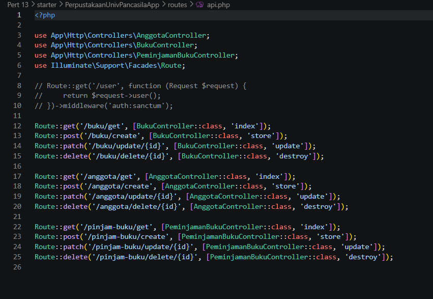

---

## 6. Percobaan Hasil API per Route

### A. Endpoint Buku

1. **GET `/api/buku/get`**

   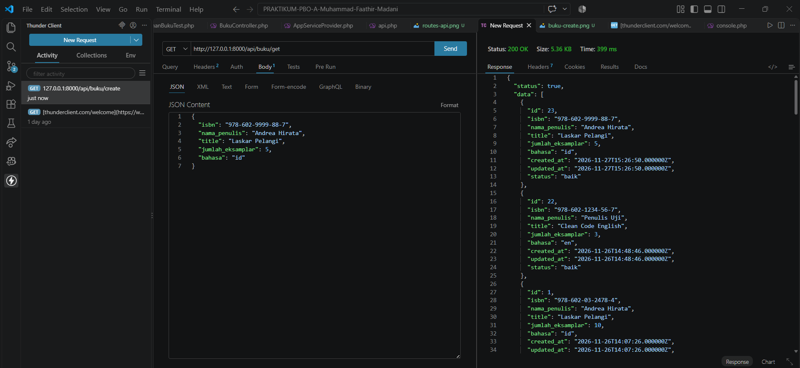

2. **POST `/api/buku/create`**

   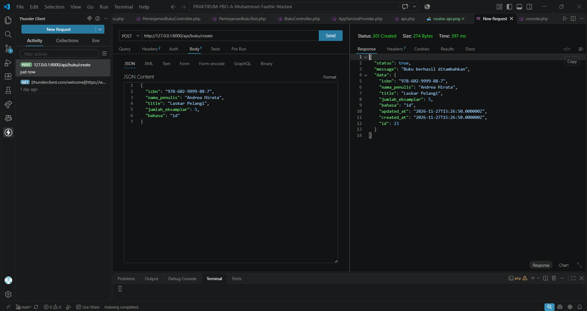

3. **PATCH `/api/buku/update/{id}`**

   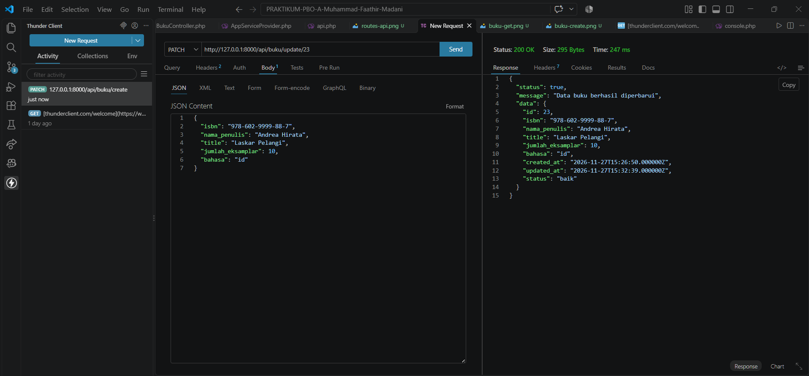

4. **DELETE `/api/buku/delete/{id}`**

   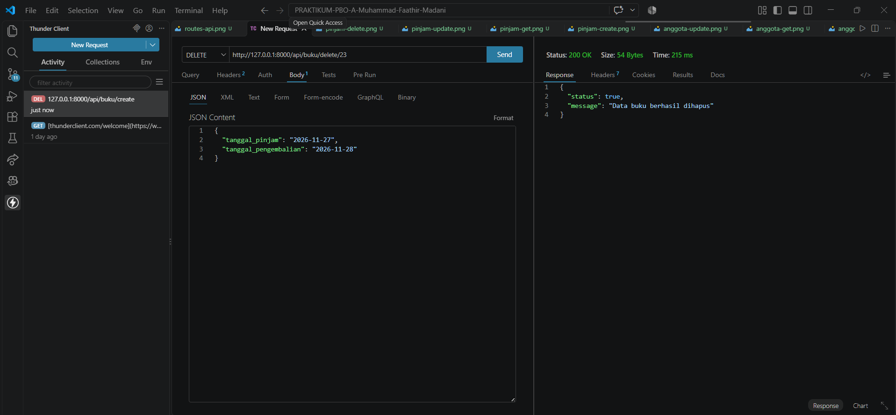

### B. Endpoint Anggota

1. **GET `/api/anggota/get`**

   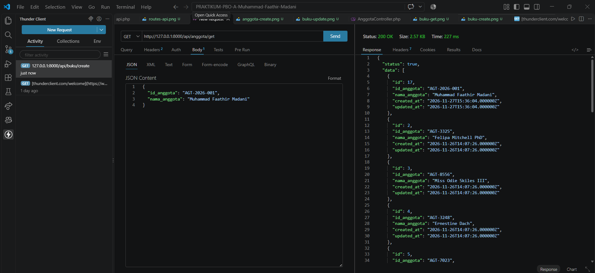

2. **POST `/api/anggota/create`**

   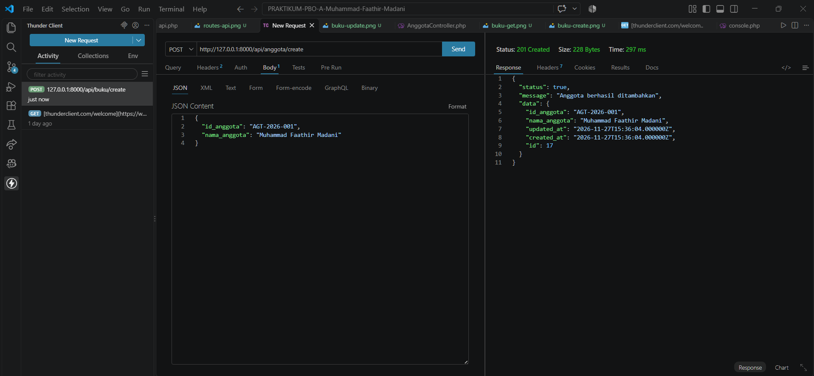

3. **PATCH `/api/anggota/update/{id}`**

   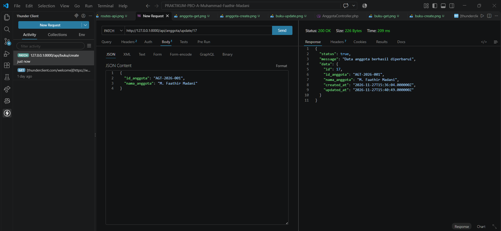

4. **DELETE `/api/anggota/delete/{id}`**

   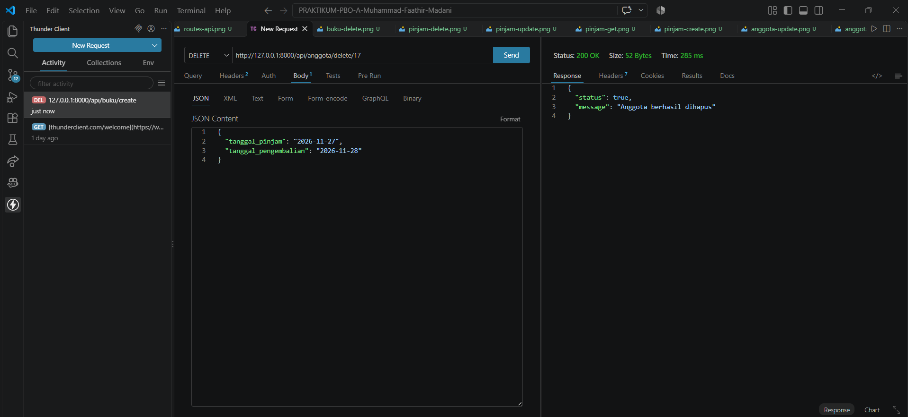

### C. Endpoint Peminjaman Buku

1. **GET `/api/pinjam-buku/get`**

   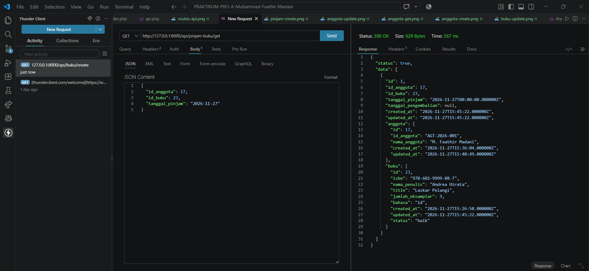

2. **POST `/api/pinjam-buku/create`**

   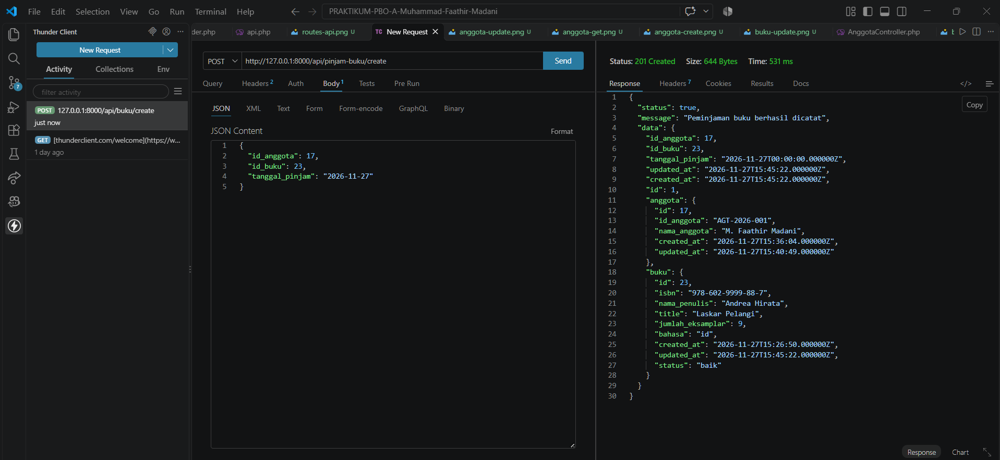

3. **PATCH `/api/pinjam-buku/update/{id}`**

   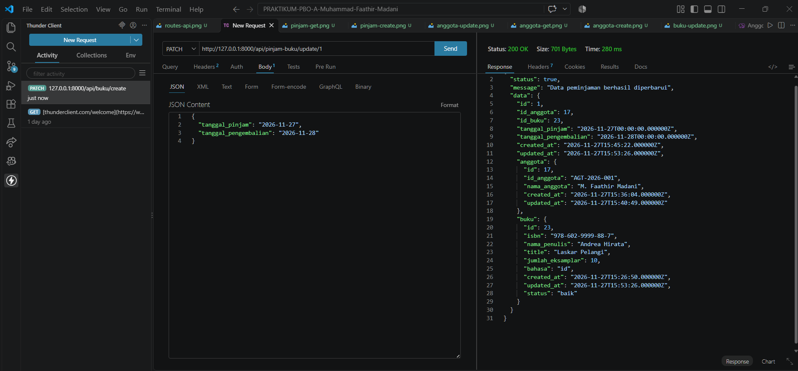

4. **DELETE `/api/pinjam-buku/delete/{id}`**

   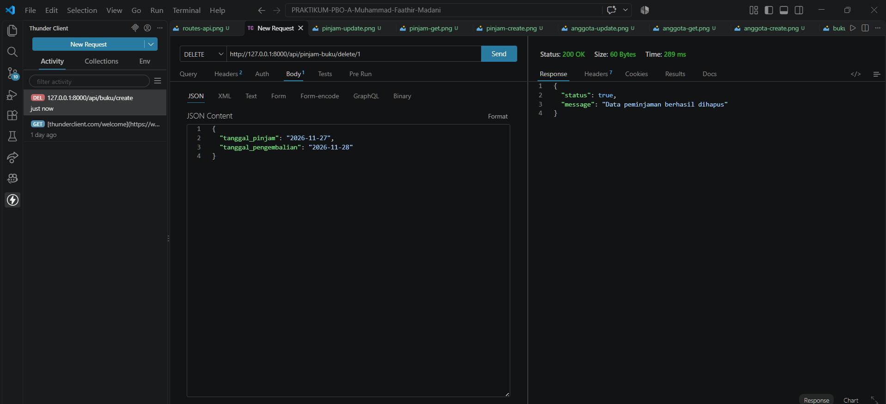