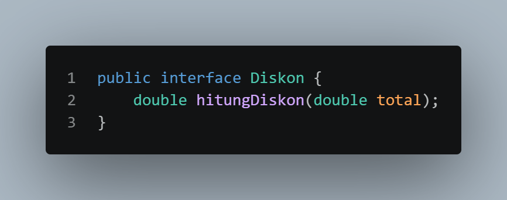
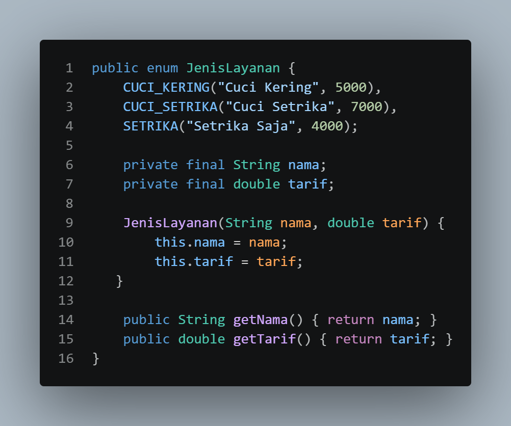
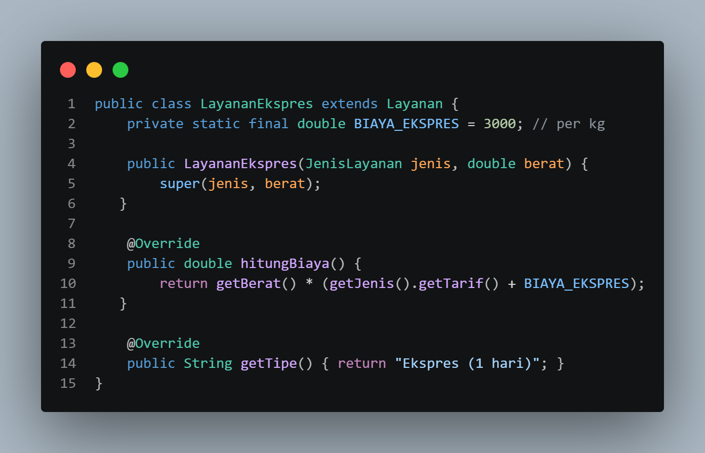
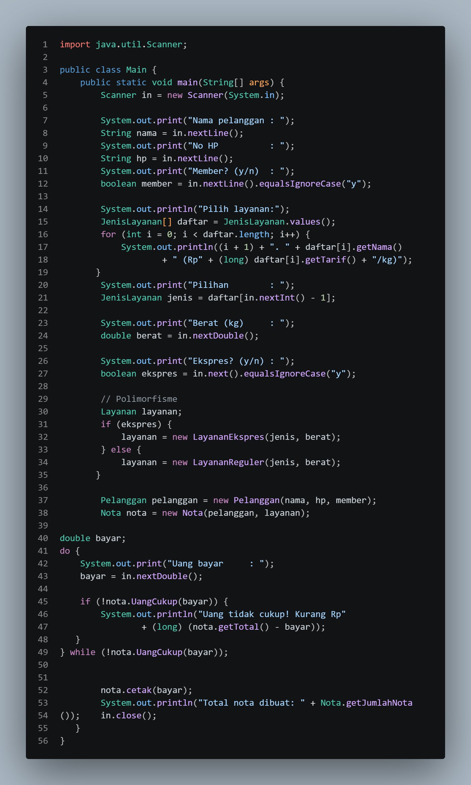

# LAPORAN UTS PRAKTIKUM PEMROGRAMAN BERBASIS OBJEK

| Informasi Proyek | Keterangan |
| :--- | :--- |
| **Mata Kuliah** | Pemrograman Berbasis Objek (PBO) |
| **Kelas** | A |
| **PJ** | Naila Putri Fahel |
| **Tema** | Sistem Pengelola Nota Laundry |
| **Tanggal** | 22 Oktober 2026 |
| **Nama** | Muhammad Faathir Madani |
| **NPM** | 4525210100 |

---

## Detail Pengerjaan & Anggota Kelompok

| Nama | NPM | Tugas / Fitur yang Dikerjakan |
| :--- | :--- | :--- |
| Mukhamad Akbar Raffael Ridho | 4525210085 | Polimorfisme - layananreguler.java |
| Vika Elda Lestari | 4525210088 | Abstract, enum - jenislayanan.java |
| Ardhelia Salsabila Al-bahri | 4525210092 | Relasi objek - Nota.java |
| Muhamad Aria Khalil Mirzahamzah | 4525210094 | Konstruktor, static, dan konstanta - Nota.java |
| Aulia Fachri | 4525210098 | Polimorfisme,Interface - diskon.java,main.java,pelanggan.java |
| Muhammad Faathir Madani | 4525210100 | Kelas, objek, dan enkasupalsi - Pelanggan.java |
| Rayza Aqsha Aditya | 4525210101 | Pewarisan - LayananExpress.java |

---

## Deskripsi Proyek
> Sistem Pengelola Nota Laundry adalah aplikasi berbasis Java CLI yang dirancang untuk mengelola transaksi pemesanan laundry secara terstruktur dan otomatis. Aplikasi ini bertujuan mempermudah perhitungan biaya pencucian berdasarkan jenis layanan (Reguler/Ekspres), status member pelanggan, dan diskon yang berlaku, serta mencetak nota transaksi secara sistematis.

**Daftar Fitur:**
1. Fitur Diskon
2. Fitur Layanan Express
3. Fitur Member Pelanggan

---

## 1. Implementasi Java

### 1.1. File: `Diskon.java`
**Penjelasan Kode:**
> File ini berisi `interface Diskon` yang mendefinisikan kontrak method `hitungDiskon(double total)`. Menerapkan konsep **Interface** untuk menyediakan abstraksi logika perhitungan potongan harga secara modular.

**Screenshot Kode:**

### 1.2. File: `JenisLayanan.java`
**Penjelasan Kode:**
> File ini berisi `enum JenisLayanan` yang mengelola himpunan konstanta pilihan paket laundry (Cuci Kering, Cuci Setrika, Setrika Saja) beserta tarif dasarnya. Menerapkan konsep **Enum** dan **Enkapsulasi** pada atribut `private final`.

**Screenshot Kode:**

### 1.3. File: `Layanan.java`
**Penjelasan Kode:**
> File ini merupakan `abstract class Layanan` yang menjadi induk kelas seluruh jenis layanan laundry. Menerapkan konsep **Abstract Class** dan **Enkapsulasi** pada atribut `jenis` dan `berat` (dilengkapi validasi di method `setBerat`), serta mendeklarasikan method abstrak `hitungBiaya()` dan `getTipe()`.

**Screenshot Kode:**

### 1.4. File: `LayananExpress.java`
**Penjelasan Kode:**
> File ini berisi kelas turunan dari `Layanan` untuk paket pengerjaan cepat. Menerapkan konsep **Pewarisan (Inheritance)**, **Konstanta (`static final`)** untuk biaya tambahan ekspres, serta **Polimorfisme (Overriding)** pada method `hitungBiaya()` dan `getTipe()`.

**Screenshot Kode:**

### 1.5. File: `LayananReguler.java`
**Penjelasan Kode:**
> File ini berisi kelas turunan dari `Layanan` untuk paket laundry standar. Menerapkan konsep **Pewarisan** dan **Polimorfisme (Overriding)** pada method `hitungBiaya()` dan `getTipe()` untuk mengkalkulasikan harga berdasarkan berat dikalikan tarif dasar.

**Screenshot Kode:**

### 1.6. File: `Nota.java`
**Penjelasan Kode:**
> File ini bertindak sebagai pengelola transaksi utama. Menerapkan **Relasi Objek (Asosiasi/Has-A)** karena menyimpan objek `Pelanggan` dan `Layanan`, variabel **`static`** untuk penomoran nota otomatis, **Konstanta** nama toko, serta kalkulasi total biaya dan pencetakan nota.

**Screenshot Kode:**

### 1.7. File: `Pelanggan.java`
**Penjelasan Kode:**
> File ini merepresentasikan data entitas pelanggan. Menerapkan konsep **Enkapsulasi** pada atribut `nama`, `noHp`, dan `member` (diakses via `getter`), serta mengimplementasikan interface `Diskon` (**Interface Implementation**) untuk memberikan potongan harga 10% khusus pelanggan member.

**Screenshot Kode:**

### 1.8. File: `Main.java`
**Penjelasan Kode:**
> File ini bertindak sebagai *entry point* atau alur eksekusi program utama. Bertanggung jawab menerima *input* interaktif melalui `Scanner`, menerapkan **Polimorfisme** pada penentuan objek `Layanan`, menginstansiasi objek `Pelanggan` dan `Nota`, serta menangani pembayaran hingga cetak nota.

**Screenshot Kode:**

### Output
**Hasil Running Program (Java):**
 
 

---

## 2. Kesimpulan
> Proyek **Sistem Pengelola Nota Laundry** berhasil mengimplementasikan prinsip-prinsip utama Pemrograman Berbasis Objek (PBO) berbasis Java CLI secara terstruktur. Penerapan **Enkapsulasi** menjaga integritas data entitas, **Pewarisan** dan **Polimorfisme** mempermudah fleksibilitas perhitungan variasi layanan (Reguler dan Express), sementara **Interface** serta **Enum** memaksimalkan kustomisasi diskon dan katalog paket. Secara keseluruhan, pembagian peran dalam kelompok berjalan efektif sehingga aplikasi mampu mengelola alur transaksi hingga pencetakan nota secara akurat dan otomatis.